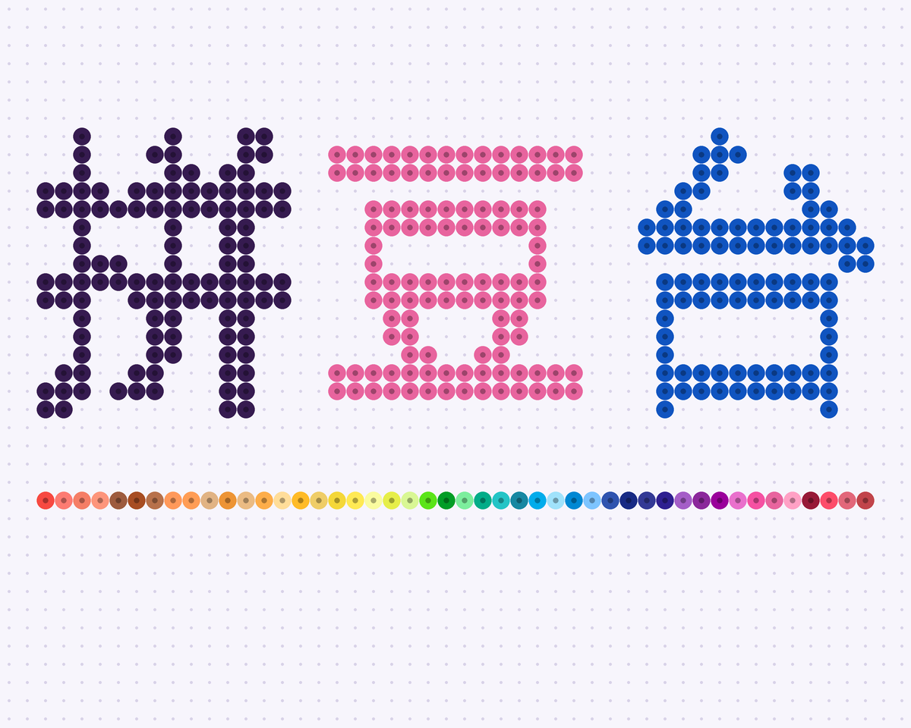

# Jamie的拼豆台

选一张图，生成每格都写好色号、可以照着拼的拼豆图纸。主要在手机浏览器里用，不用安装，也不用注册。

[](LICENSE)

**在线使用：<https://jamie-pindou.vercel.app>**



## 关于

拼豆是把彩色小豆子按图纸插在豆板上，再熨烫成型的手工。难点在图纸：要把图片换算成每一格的色号，并算出每种颜色要多少颗。

拼豆台在手机上完成这件事。图片全程只在你的设备上处理，不会上传，项目也没有业务后端。

## 功能

- **项目页：** 保存多张图纸，可以重命名和删除，页面被关掉后也能接着做。
- **像素画识别：** 自动找到原图的像素网格，每一格对应原图的一个像素，并裁掉空白和水印这类零碎内容。
- **轮廓优先：** 细线不会被背景吃掉，断开的轮廓会接上，去白底不会挖空主体内部。
- **调整图纸：** 图片类型、尺寸、轮廓、色彩、颜色合并都能改，图纸实时更新。
- **色号标准：** MARD（221 色或 291 色）、COCO、漫漫、盼盼、咪小窝、Hama Mini、Perler Mini、Artkal C。
- **控制颜色：** 颜色上限；也可以只用自己手上有的颜色。
- **三个视图：** 原图、拼好后的效果图、每格带色号的图纸。
- **修改图纸：** 左右镜像、去除白底、逐格修改、多选改色、整色替换、撤销和重做。
- **颜色清单：** 按颗数排序；点一个颜色，图上只亮这个颜色，方便边拼边找。
- **导出图纸：** 一张 PNG，带色号、行列坐标、每 5 格粗线和颜色清单。

尺寸都按 2.6mm 的豆子计算，例如 52×52 的成品边长约 13.5 cm。

## 使用

1. 打开[在线版本](https://jamie-pindou.vercel.app)，点“新建图纸”，选一张图片或现场拍照。
2. 框出要拼的范围。像素画会默认跟随原图的格子，也可以自己选尺寸。点“生成图纸”。
3. 在结果页查看和修改；效果不理想就点“调整图纸”。最后点“下载图纸”保存到手机。

## 算法

| 步骤 | 做法 |
| --- | --- |
| 识别网格 | 找出原图中颜色突变的位置，拟合最符合的像素周期。整数倍放大的小图另外逐块核对 |
| 取色 | 取每格最常见的颜色而不是平均色，边缘不会发灰；浅色格里的深色细线可以胜出 |
| 配色 | 用 CIEDE2000 色差匹配最接近的豆子；像素画默认先加深并提高饱和度 |
| 去背景 | 从图片边缘向内找近白色，先补上轮廓的小缺口，所以不会漏进主体 |
| 统一轮廓 | 外圈的格子参考相邻外圈的颜色，接近的统一成一种 |

## 本地运行

需要 Node.js 20.19 或 22.12 以上。

```bash
git clone https://github.com/billzhuang6569/jamie-pindou.git
cd jamie-pindou
npm install
npm run dev
```

开发服务器监听局域网。手机连同一个 Wi-Fi 后，打开终端显示的 Network 地址就能预览。

| 命令 | 作用 |
| --- | --- |
| `npm run dev` | 启动开发服务器 |
| `npm test` | 运行测试 |
| `npm run build` | 类型检查并构建到 `dist/`，产物是纯静态文件 |
| `npm run preview` | 预览构建结果 |
| `npm run palettes` | 用 `data/sources/` 重新生成色板数据 |

系统分享面板只在 HTTPS 下可用，HTTP 下保存图纸会改为直接下载。

## 项目结构

| 路径 | 内容 |
| --- | --- |
| `src/core/pattern.ts` | 把图片和设置变成图纸的完整流程 |
| `src/core/pixelGrid.ts` | 识别像素网格 |
| `src/core/outline.ts` | 去背景、补轮廓、统一外圈颜色 |
| `src/core/` 其余文件 | 色差、取色匹配、图纸编辑、绘制和导出 |
| `src/ui/` | 页面和组件 |
| `src/storage.ts` | 把图纸保存在本机 |
| `data/sources/` | 固定版本的色号源数据，[来源和处理规则](data/sources/README.md)写在这里 |
| `scripts/build-palettes.mjs` | 把源数据生成为 `src/data/palettes.json` |
| `tests/` | 核心算法测试 |

## 已知限制

- **色值是屏幕近似。** 数据没有和实物色卡核对过，大量买豆前请对照实物。
- **部分品牌靠对照表。** COCO、漫漫、盼盼、咪小窝的色号来自社区对照表，屏幕色值沿用对应的 MARD 色值。
- **部分品牌和规格还没有数据。** 小舞、黄豆豆、动木木，以及 72、96、144 色这类子集，暂时没找到公开清单。如果你有可靠来源，欢迎提交。
- **`vercel.app` 在中国大陆可能打不开。** 可以自己部署 `dist/` 到别的静态托管。
- **图纸只存在本机。** 换手机或清除浏览器数据后不会保留，要留底请下载图纸。

## 参与贡献

欢迎提 Issue 和 Pull Request。提交前请运行：

```bash
npm test
npm run build
```

贡献色号数据时，请写明来源和许可，并更新 [data/sources/README.md](data/sources/README.md)。

## 致谢

- [maxcleme/beadcolors](https://github.com/maxcleme/beadcolors)：多品牌色号和色值。
- [Zippland/perler-beads](https://github.com/Zippland/perler-beads)：国产品牌的色号对照表。

完整的第三方声明见 [NOTICE.md](NOTICE.md)。

## 许可

Copyright (C) 2026 billzhuang6569

本项目按 [AGPL-3.0](LICENSE) 开源。如果你修改后把它作为网络服务提供给别人使用，也要向这些用户提供修改后的源代码。
